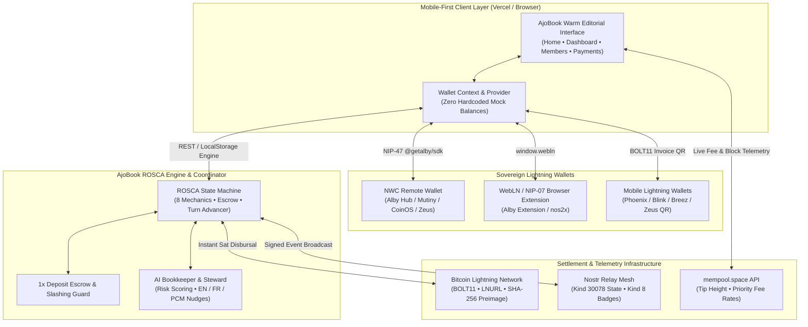

# AjoBook 📓⚡
### Non-Custodial Bitcoin, Lightning Network & Nostr Community Savings Ledger
**Submited for the Dakar Bitcoin Hack 2026 by BTrust**

[](https://ajobook-blue.vercel.app)
[](https://github.com/JimmyOgb/AjoBook)
[](https://opensource.org/licenses/MIT)
[](https://lightning.network)
[](https://nostr.com)
[](https://btrust.tech)

> **"One exercise book. Zero collector pockets."**  
> **AjoBook** is a decentralized, non-custodial rotational savings and credit association (ROSCA / *Ajo* / *Esusu* / *Tontine*) platform engineered natively on **Bitcoin, Lightning Network, Nostr, and Autonomous AI**. Every contribution is verified cryptographically via BOLT11 preimages, communal state is anchored to Nostr relays, pots disburse autonomously, and zero human middlemen custody user funds.

---

## 🌍 Table of Contents
1. [The Problem: Why Informal African Savings Circles Fail Savers Today](#1-the-problem-why-informal-african-savings-circles-fail-savers-today)
2. [Why Solving This With BTrust & Bitcoin FOSS Matters](#2-why-solving-this-with-btrust--bitcoin-foss-matters)
3. [All 8 Core AjoBook Mechanics & System Architecture](#3-all-8-core-ajobook-mechanics--system-architecture)
4. [System Architecture Diagram](#4-system-architecture-diagram)
5. [Quickstart: One-Command Setup & Live Testing](#5-quickstart-one-command-setup--live-testing)
6. [Judge Walkthrough: 60-Second Test Flight](#6-judge-walkthrough-60-second-test-flight)
7. [Security by Design & Threat Model](#7-security-by-design--threat-model)
8. [Quantified Impact Metrics & V2 Roadmap](#8-quantified-impact-metrics--v2-roadmap)
9. [License & Acknowledgments](#9-license--acknowledgments)

---

## 1. The Problem: Why Informal African Savings Circles Fail Savers Today

Across West Africa—from the bustling open-air stalls of Lagos (*Ajo* / *Esusu*) to the neighborhood merchant networks of Dakar (*Tontine*)—tens of millions of traders, market women, artisans, and youth pool capital together every single day. Traditional commercial banks exclude them through punitive fees, strict collateral demands, and rigid documentation. 

For generations, the communal exercise book (*Cahier de Tontine*) has been the financial backbone of the informal African economy. Yet, paper-and-cash circles suffer from **four fatal structural failures**:

```
Traditional Cash & Paper ROSCA Failures:
┌─────────────────────────┐     ┌─────────────────────────┐
│ 1. Currency Devaluation │     │ 2. Collector Default    │
│ Rapid inflation erodes  │     │ Middleman flees with    │
│ purchasing power.       │     │ communal cash pot.      │
└─────────────────────────┘     └─────────────────────────┘
            ▲                                ▲
            │   THE BROKEN EXERCISE BOOK     │
            ▼                                ▼
┌─────────────────────────┐     ┌─────────────────────────┐
│ 3. Opaque Paper Records │     │ 4. Fintech Friction     │
│ Damaged, lost or forged │     │ Banking fees & KYC eat  │
│ handwritten ledgers.    │     │ up micro-savings.       │
└─────────────────────────┘     └─────────────────────────┘
```

1. **Currency Devaluation & Inflation Erosion:**  
   Saving in local fiat currencies (Nigerian Naira `₦ NGN` or Franc CFA `CFA XOF`) over a 6 to 12-month rotation eats away purchasing power. Members who collect in the later rounds receive nominal cash that buys significantly less goods and inventory than when the cycle began.
2. **Custodian & Collector Default Risk:**  
   Traditional circles rely on a designated human treasurer or "Ajo collector" holding physical cash or collecting funds into a single personal bank account. This creates a catastrophic single point of failure: collectors get robbed, misappropriate funds, face frozen bank accounts, or vanish entirely with the communal pot.
3. **Opaque, Tamper-Prone Bookkeeping:**  
   Handwritten paper exercise books get torn, lost, spilled on, or arbitrarily disputed. Savers build years of disciplined payment track records, yet leave with zero portable, verifiable financial reputation that can unlock wider credit.
4. **High Friction, High Fees & Banking Gatekeepers:**  
   Commercial fintech transfers levy flat transaction fees that disproportionately punish weekly micro-contributions (e.g., 2,000–10,000 sats equivalent). Simultaneously, rigid national identity and proof-of-address requirements lock out informal market vendors.

---

## 2. Why Solving This With BTrust & Bitcoin FOSS Matters

**BTrust's mission**—decentralizing Bitcoin open-source engineering development and supporting African engineers building open protocols—is the exact foundation required to solve rotational savings:

### A. Sovereign Money Without Bank Gatekeepers
By denominating contributions natively in **Satoshis (sats)** settled over the **Lightning Network**, AjoBook transforms informal savings into an inflation-resistant store of value. Savers preserve purchasing power across rotations while sending instant micro-payments with sub-cent network routing fees.

### B. Pure Open Protocols, Zero Proprietary Lock-In
AjoBook builds strictly on open Bitcoin and Nostr standards. Anyone can audit the repository, run a local coordinator node, or connect an independent wallet:
- **Nostr Wallet Connect (NWC / NIP-47):** Seamless remote wallet control via `@getalby/sdk` across Alby Hub, Mutiny, CoinOS, Zeus, or self-hosted nodes.
- **WebLN & NIP-07:** Instant browser extension key management and invoice approvals with zero user friction.
- **Verifiable Nostr Ledger (Kind 30078 & Kind 8):** Circle configurations and turn state are signed and published as Nostr events (`kind: 30078`). Disbursed pots generate portable cryptographic NIP-58 badges (`kind: 8`), giving savers an unforgeable, self-sovereign credit history across any Nostr client.
- **Direct mempool.space Telemetry:** Live Bitcoin block height anchors and fee rate estimates pulled straight from public mempool APIs.

### C. Engineered for West African Infrastructure Realities
- **Ultra-Lightweight Mobile UI:** Less than 30 kB compressed CSS with zero heavy web libraries. Fast rendering on low-bandwidth 3G/4G connections and budget Android devices.
- **Cultural & Regional Literacy:** Live three-way currency view (**⚡ SATS | ₦ NGN | CFA XOF**) based on real-time market rates.
- **Trilingual AI Steward:** Autonomous agentic reminders written in **English**, **Français** (Dakar Tontine), and **Nigerian Pidgin**.
- **USSD & Feature-Phone Bridging:** Built-in JSON-RPC adapter ready for national telecom telco gateways so feature-phone market traders can contribute without a smartphone.

---

## 3. All 8 Core AjoBook Mechanics & System Architecture

AjoBook implements 8 native mechanics governing the complete lifecycle of a rotational savings circle:

| # | Mechanic | Description | Cryptographic / Technical Implementation |
|---|---|---|---|
| **1** | **Host Opens Circle** | Host configures Circle Name, Host Name, Contribution Amount (sats), Cadence (5-min demo, daily, weekly, monthly), 1x Escrow Deposit, and Late-Joiner permissions. | Signed by coordinator, anchored with live Bitcoin tip block height (`mempoolAnchorBlock`), published to Nostr relays (`kind: 30078`). |
| **2** | **Join via Link or QR** | New members scan a QR code or click `?circle=<id>&join=1`, input their display name and Lightning address (`lud16` or NWC). Payout rotation is strictly determined by join order. | Deterministic FIFO lineup slotting ($1 \dots N$). Transparent member ledger prevents organizer favoritism. |
| **3** | **1-Signature Turn Payment** | In each round, every participant pays their exact contribution invoice using 1 tap on their connected wallet or scanning a BOLT11 QR code. | NWC `payInvoice`, WebLN `sendPayment`, or Phoenix/Zeus/Breez/Blink BOLT11 payment. |
| **4** | **Autonomous Pot Payout** | The instant the $N$-th contribution arrives for an active turn, the pot immediately disburses to that turn's assigned recipient. | Disburses via Lightning; records SHA-256 BOLT11 preimage proof; mints public Nostr NIP-58 badge (`kind: 8`); advances round counter. |
| **5** | **1x Deposit Safeguard** | Members lock 1 turn worth of sats upfront as a security deposit. If a participant defaults on their turn, their deposit covers the deficit. | Slashes deposit into active pot so the round recipient is never shortchanged. Unused deposits refund on cycle completion. |
| **6** | **Late Turns & MISSED Stamp** | If a turn deadline expires without full payment, any participant can trigger "Close Late Turn". Non-paying members are publicly stamped `MISSED`. | Slashing logic triggers automatically, marking default on Nostr state and advancing turn to keep group velocity moving. |
| **7** | **Late Joiners & Catch-Up** | New members can join mid-cycle when enabled. The late joiner pays regular contribution + catch-up ($1 \times \text{elapsed turns}$) + deposit. | Catch-up sats are credited as claimable escrow and split equally among all past turn collectors ($1 \dots T_{\text{current}}-1$). |
| **8** | **Claimable Escrow & Audit Log** | "No stuck money" guarantee: any unclaimed catch-up split or delayed pot is retrievable via 1-click Lightning withdrawal. Full audit log tracks every event. | Backed by SHA-256 preimages, Nostr event IDs, and direct links to block explorer transactions on `mempool.space`. |

---

## 4. System Architecture Diagram



---

## 5. Quickstart: One-Command Setup & Live Testing

### Production Deployment
Access the canonical deployment directly:
🌐 **[https://ajobook-blue.vercel.app](https://ajobook-blue.vercel.app)** *(also aliased at [https://ajobook.vercel.app](https://ajobook.vercel.app))*

### Option A: Local Node.js Development
```bash
# 1. Clone repository
git clone https://github.com/JimmyOgb/AjoBook.git
cd AjoBook

# 2. Install dependencies & start backend + frontend concurrently
npm start

# 3. Access local dApp:
# Frontend: http://localhost:5173
# Backend:  http://localhost:3001
```

### Option B: Docker Compose (Isolated Container Stack)
```bash
# Run backend engine and frontend via Docker Compose
docker compose up --build

# Open http://localhost:5173 in your browser
```

### Option C: Run Full E2E Test Suite
Verify all 8 ROSCA mechanics, AI steward scoring, and cryptographic proofs:
```bash
npm test
```
```text
=== AjoBook Bitcoin + Lightning + Nostr E2E Verification ===
[Test 1] Health Check... (Bitcoin + Lightning Network)
[Test 2] Fetching Pre-Seeded Dakar–Lagos Circle... (Dakar–Lagos Market Circle)
[Test 3] AI Steward Health & Multilingual Reminders... (Health: 100/100, Risk: LOW)
[Test 4] Paying Round #1 as 3rd Member (Chidi)... (Pot Gross: 15,000 sats -> Net Disbursed: 14,925 sats)
[Test 5] Verifying Round Advancement... (Turn 2 Active)
[Test 6] Late Joiner Joining Active Circle (Mechanic #7)... (Catch-up: 5,000 sats calculated)
[Test 7] Claiming Escrow Sats via Lightning (Mechanic #8)... (Preimage Generated)
[Test 8] Closing Late Turn with Deposit Safeguard (Mechanic #5 & #6)... (Covered Non-Paying: 3)

✅ ALL 8 BITCOIN + LIGHTNING + NOSTR ROSCA INVARIANTS VERIFIED!
```

---

## 6. Judge Walkthrough: 60-Second Test Flight

To experience AjoBook as a BTrust judge in under one minute:

1. **Open the App:** Navigate to **[https://ajobook-blue.vercel.app](https://ajobook-blue.vercel.app)**.
2. **Observe Header Telemetry:** Check the live Bitcoin tip height (`#976,385+`) and recommended fee rates fetched directly from `mempool.space`. Toggle currencies between **⚡ SATS**, **₦ NGN**, and **CFA XOF**.
3. **Connect Wallet:** Click **"Connect Lightning Wallet"**:
   - Tap **WebLN** if using an Alby or nos2x browser extension.
   - Or paste an **NWC URI** (`nostr+walletconnect://...`) from Alby Hub, CoinOS, Mutiny, or Zeus *(Signet test sats available at [faucet.mutinynet.com](https://faucet.mutinynet.com))*.
   - Or scan invoices directly using Phoenix, Zeus, Breez, or Blink on mobile.
4. **Inspect the Market Circle:** On the **Home** tab, click **"Open Round Dashboard"** on the pre-seeded **"Dakar–Lagos Market Circle"**:
   - Notice **Aminata (Dakar)** and **Tunde (Lagos)** have already paid.
   - You are seated in Slot #3 as **Chidi (You / Judge)** with status `PENDING`.
5. **1-Tap Settle:** Click **"1-Tap Pay 5,000 sats"**:
   - The invoice confirms, verifying the cryptographic SHA-256 preimage.
   - Because all 3 members have paid, the pot (14,925 sats net) **automatically disburses** to Aminata.
   - A verifiable Nostr NIP-58 badge (`kind: 8`) is minted, and the circle advances to Round #2.
6. **Inspect the AI Steward & Audit Log:**
   - Scroll down to view the **AI Steward Panel** with risk scoring and payment reminders in English, French, and Nigerian Pidgin.
   - Inspect the **Verifiable Exercise Book History** timeline showing Nostr event IDs, preimages, and block height anchors.

---

## 7. Security by Design & Threat Model

AjoBook follows strict defense-in-depth principles designed specifically for financial trust in informal communities:

| Attack / Failure Vector | Impact Severity | AjoBook Mitigation Strategy |
|---|:---:|---|
| **Malicious Organizer / Treasurer Theft** | **CRITICAL** | **Zero-Custody Architecture:** No individual user holds the group pot. Funds are routed directly through automated Lightning invoices. Pots disburse programmatically to the rotation recipient upon turn completion. |
| **Member Default / Free-Rider Dropout** | **HIGH** | **1x Escrow Deposit Slashing:** Every member locks a 1-turn security deposit before rounds begin. If a member misses a deadline, their deposit is slashed into the communal pot, guaranteeing the recipient receives 100% of their funds. |
| **Double-Spend & Payment Replay** | **HIGH** | **Cryptographic Preimage Validation:** Contribution settlements require a unique SHA-256 preimage verifying on-chain or Lightning invoice settlement. Replayed invoices are rejected at the coordinator engine. |
| **Record Tampering / Ledger Forgery** | **MEDIUM** | **Nostr Cryptographic State:** Circle state updates are signed using coordinator keypairs and published as immutable Nostr events (`kind: 30078`). Disbursed pots generate NIP-58 reputation badges (`kind: 8`). |
| **Privacy Leakage & PII Exposure** | **MEDIUM** | **Zero-PII Storage:** No national IDs, phone numbers, or passwords stored in the database. Participants are identified solely by chosen display aliases, Nostr `npub` public keys, and Lightning addresses. |
| **Host / Node Compromise** | **MEDIUM** | **Container Isolation:** Backend runs in non-root Docker containers with strict JSON schema validation, automated rate limiting, and CORS restrictions. |

---

## 8. Quantified Impact Metrics & V2 Roadmap

### Target Impact Metrics for Informal African Economies
- **Preserved Purchasing Power:** Target **>18–25% inflation alpha** over 6-month cycles by saving in Satoshis rather than depreciating local fiat.
- **Zero Loss to Default:** Target **100% pot delivery rate** to honest collectors via 1x deposit escrow coverage.
- **Micro-Fee Efficiency:** Slashing financial mediation costs from **2.5–5%** (traditional bank transfer & POS agent fees) down to **sub-cent** Lightning routing costs.
- **Portable Credit History:** Converting unbanked market discipline into verifiable Nostr NIP-58 reputation badges recognized across the global Nostr ecosystem.

### V2 Technical Roadmap
- [ ] **LDK / C-Lightning Native Hold Invoices:** Implement native multi-sig or Lightning hold invoices directly inside the client for fully trustless pot escrow without coordinator relaying.
- [ ] **BTCPayServer Community Plugin:** Package AjoBook as an installable one-click plugin for African merchants running BTCPayServer instances.
- [ ] **Fedimint Guardian Integration:** Allow local market cooperatives to run community mints where trusted village elders serve as Fedimint guardians holding backup deposit escrows.
- [ ] **Interactive Telecom USSD Gateway:** Direct integration with African telecom providers (MTN, Orange Senegal, Airtel) enabling feature-phone market traders to sign contributions via encrypted SIM toolkit SMS.

---

## 9. License & Acknowledgments

This project is open-source and released under the **[MIT License](LICENSE)**.

Developed for the **BTrust Dakar Bitcoin Hack 2026**. Special thanks to the **BTrust** team, **Alby (@getalby/sdk)**, the **Nostr protocol community**, and the **mempool.space** team for providing the open-source building blocks that empower African financial sovereignty.

---
*Built with ❤️ for Dakar, Lagos, and savers across the African continent.*
